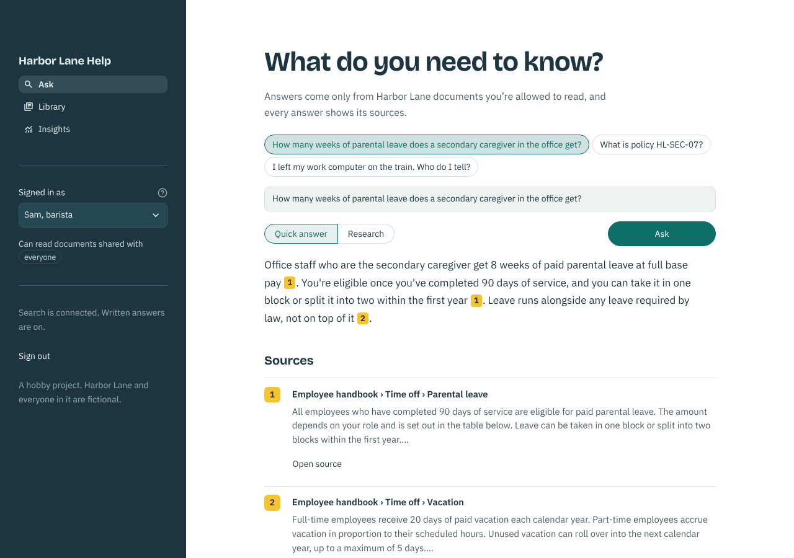
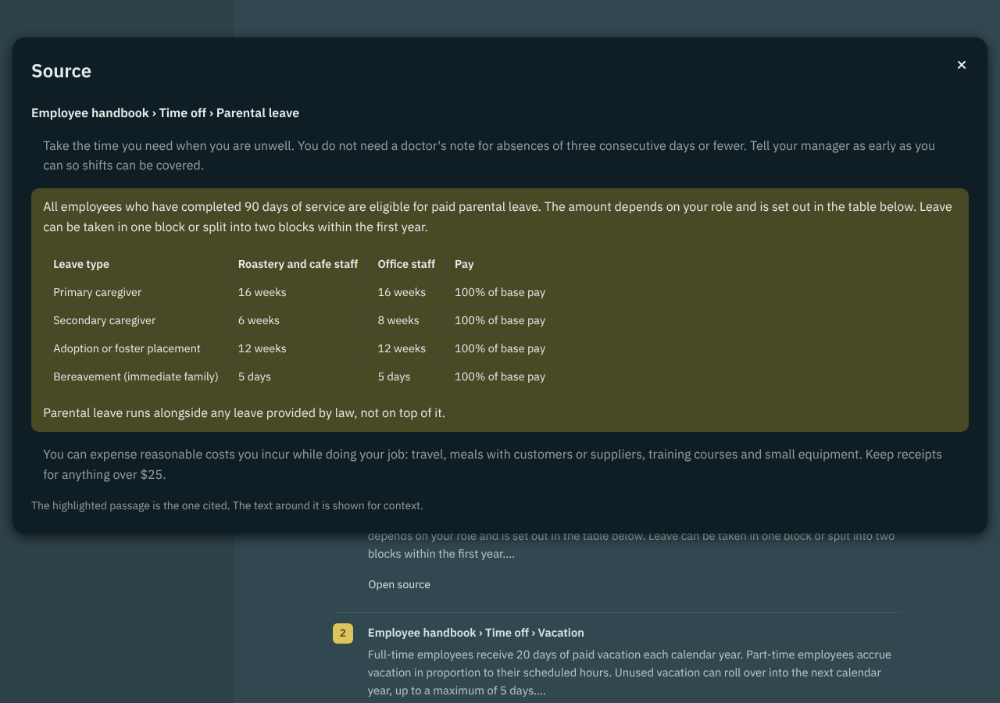

# Harbor Lane Help

> **A personal hobby project.** I built this to learn how a production-style retrieval app fits together. It isn't affiliated with or endorsed by turbopuffer or Anthropic, and it isn't meant for real company data. Harbor Lane Coffee Roasters, its staff and its documents are all fictional.

An internal help desk for a (fictional) coffee roaster. Staff ask a question and get a short answer drawn only from documents they're allowed to read, with every claim cited and every source one click away. Built with [Streamlit](https://streamlit.io), [turbopuffer](https://turbopuffer.com) for search, and [Claude](https://www.anthropic.com/claude) for answers.



## What it does

- **Ask.** Type a question or pick a suggestion. *Quick answer* runs one search and streams a cited answer. *Research* lets Claude run several searches for questions with more than one part, showing each step as it happens. Citations are highlighted in signal yellow; open any source to see the cited passage highlighted in its surrounding text.
- **Permissions.** Switch who you're signed in as (barista, manager, finance lead, people team) and the answers change, because every search is filtered to the documents your groups may read. There is no code path that searches without that filter.
- **Library.** See the documents shared with you, add a PDF, Markdown or text file and watch it parsed, chunked, embedded and indexed, inspect any document's chunks, or remove one. **Delete all data** at the bottom wipes everything this app stored in turbopuffer (after a confirmation), and you can reload the sample library afterwards.
- **Insights.** Timings for this session's questions (search time, time to first words, tokens), and a 16-question test set that scores each search mode on whether the right section comes back first or in the top three, plus a count of restricted passages returned (always 0).



## How it works

```
Write path:  file ─▶ parse (pymupdf4llm, header/footer cleanup) ─▶ chunk by heading (~300 tokens)
                  ─▶ turbopuffer: native embedding + BM25 index, groups on every chunk ─▶ library registry

Read path:   question ─▶ turbopuffer hybrid search, filtered by ("groups", "ContainsAny", your_groups)
                      ─▶ rerank ─▶ Claude writes a cited answer (streamed)
             research ─▶ Claude calls tools (list documents, search, read around) until it can answer
```

| Module | Job |
|---|---|
| `helpdesk/config.py` | Settings from environment variables |
| `helpdesk/tpuf.py` | turbopuffer client (3 retries, 30 s timeout) and schema |
| `helpdesk/parsing.py`, `chunking.py`, `ingest.py` | The write path |
| `helpdesk/retrieval.py` | Permission-filtered search; refuses to run without groups |
| `helpdesk/answer.py` | Streamed answers and the research agent (capped at 5 rounds) |
| `helpdesk/evals.py` | The golden test set and scoring |
| `helpdesk/telemetry.py` | One JSON log line per question, without the question text |
| `views/` | The Ask, Library and Insights pages |

## Production habits it tries to show

- API keys stay on the server; the browser never sees them.
- One namespace per tenant, with group filters inside every query, so a restricted passage can't reach a person or the model writing their answer.
- Retries with backoff and timeouts on both turbopuffer and Claude; friendly error states instead of stack traces.
- A per-session rate limit to protect the API budget.
- Re-uploading a document replaces it cleanly (delete by filter, then write).
- Structured logs and per-stage timings, so you can say where every millisecond went.
- A test suite with an in-memory turbopuffer and a scripted Claude, run on every push by GitHub Actions. No keys needed.

What it deliberately doesn't do: real sign-in (the persona picker stands in; swapping in Streamlit's `st.login` with your identity provider only changes where the groups come from), persistent query logs, or multi-language code paths.

## Configuration

Only two settings are required, plus one optional:

| Variable | Needed? | What it does |
|---|---|---|
| `APP_PASSWORD` | Required | The password on the sign-in page. The app won't open without it. Pick anything. |
| `TURBOPUFFER_API_KEY` | Required | Search and storage. |
| `ANTHROPIC_API_KEY` | Optional | Turns on written answers and Research mode. Without it you still get search results and sources. |

On **Streamlit Community Cloud**, paste these under App settings → Secrets:

```toml
APP_PASSWORD = "choose-a-password"
TURBOPUFFER_API_KEY = "tpuf_..."
ANTHROPIC_API_KEY = "sk-ant-..."
```

**Running locally**, put the same three in a `.env` file without quotes (`APP_PASSWORD=choose-a-password`) and load it into your shell before starting the app (see below).

Everything else has a default and can usually be left alone; `.env.example` lists them all:

| Variable | Default | Notes |
|---|---|---|
| `TURBOPUFFER_REGION` | `gcp-us-central1` | Where your data lives. Pick a region where your plan supports native embedding. |
| `TENANT` | `harbor-lane` | Part of the namespace names, so one account can hold several tenants. |
| `NAMESPACE_PREFIX` | `hlhelp` | Prefix for every namespace this app creates. |
| `EMBED_MODEL` / `EMBED_DIMS` | `nvidia/nemotron-3-embed-8b` / `1024` | turbopuffer's native embedding model and vector size. Changing these needs a fresh library. |
| `RERANK_MODEL` | `zeroentropy/zerank-2` | Used by quick answers; falls back to fused results if unavailable. |
| `CLAUDE_MODEL` | `claude-sonnet-5-5` | The model that writes answers. |
| `QUESTIONS_PER_MINUTE` | `8` | Per-session rate limit. |

Don't set `TURBOPUFFER_BASE_URL` in a real deployment. It exists only so the tests can point at the in-memory fake, and setting it would send every search to an address that doesn't exist.

## Run it locally

```bash
python3 -m venv .venv && source .venv/bin/activate
pip install -r requirements.txt
cp .env.example .env        # set APP_PASSWORD, TURBOPUFFER_API_KEY, optionally ANTHROPIC_API_KEY
set -a; source .env; set +a
streamlit run app.py
```

Sign in with your `APP_PASSWORD`, then click **Load sample library** on the Ask page. Without an Anthropic key, search and sources still work; written answers and research mode are off.

## Deploy to Streamlit Community Cloud

Create an app from this repo with `app.py` as the main file, and add the secrets from [Configuration](#configuration) under **Advanced settings → Secrets** (`.streamlit/secrets.toml.example` has them ready to copy). The theme (fonts, light and dark colours) comes from `.streamlit/config.toml` automatically. Free apps sleep when idle, so open the link a minute before you need it.

## Tests

```bash
pip install -r requirements-dev.txt
pytest
```

26 tests cover parsing and chunking, re-uploads, deletes and wiping all data, permission filtering for every persona and question, the streamed answer, the research loop (including its step cap and a failing tool), the evaluation, the UI helpers, and a headless click-through of the app.

## A short demo

1. As **Sam, barista**, ask "How many weeks of parental leave does a secondary caregiver in the office get?" The answer comes from a table in a PDF; open the source to see the table with the cited passage highlighted.
2. Ask "What's the pay range for a roastery supervisor?" Sam is told it isn't in the documents he can read. Switch to **Priya, roastery manager** and ask again: she gets the salary bands.
3. Switch to **Research** and ask "I'm going to London for three days with a $600 hotel. What can I spend on meals, and who approves the hotel?" Watch Claude split it into separate searches, then open *How this answer was found*.
4. On **Library**, compare what Sam and Dana can see, and add a document of your own.
5. On **Insights**, run the test set and compare search modes.

## Costs

Parsing and chunking run locally. turbopuffer usage for a library this size is tiny, though paid plans have a monthly minimum. Each Claude answer costs a fraction of a cent.

## License

MIT. See [LICENSE](LICENSE).
